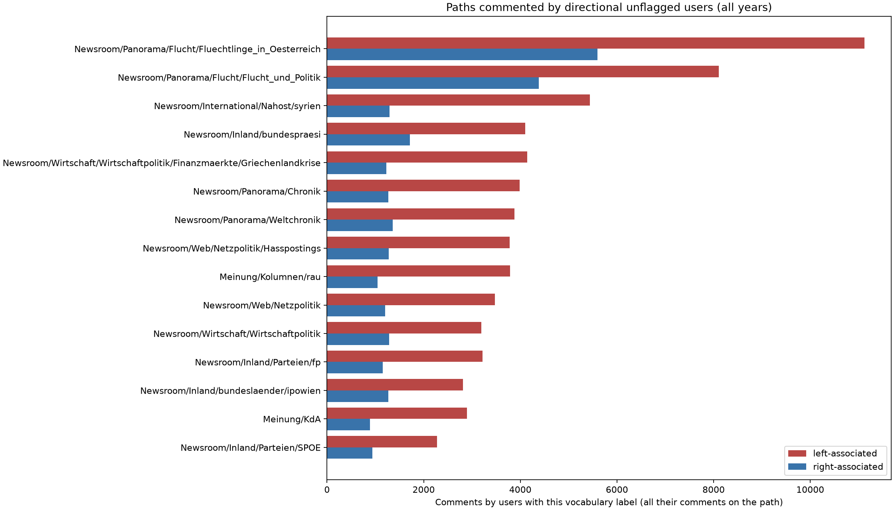
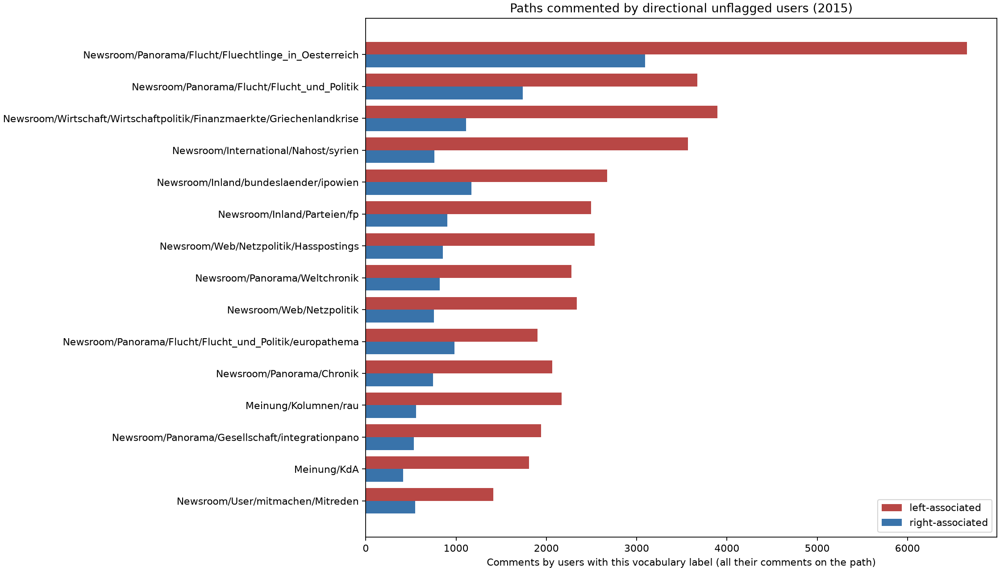
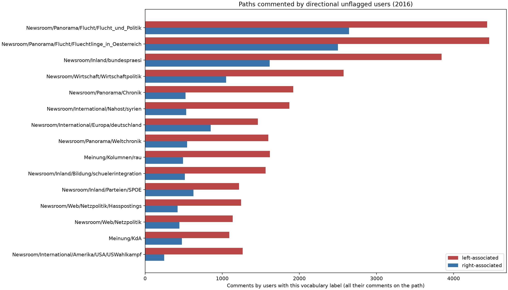

# Paths commented by directional unflagged users

## Contents
- [All years](#all-years)
- [2015](#2015)
- [2016](#2016)

Run `main-lexicon-2026-10-12`, manifest SHA-256 `21374e6aef40`, Git revision `eef4a8db217f` (uncommitted changes), lexicon `main-crisis-v1`.

Directional users: **2,108** (at least 1 directional comment and at least 68% agreement). Each chart shows the 15 paths with
the most comments by these users.

## All years

## 2015

## 2016

